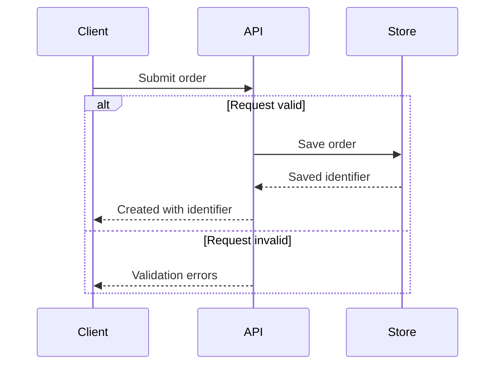

# Behavior and data diagram practices

Reviewed: 2026-10-18 against Mermaid documentation. Baseline: established Mermaid 11/12 syntax;
the bundled renderer setup uses Mermaid CLI 12.0.0. Host support must be checked separately.
The rules below are toolkit recommendations informed by the linked tool documentation.

| Notation | Checks before delivery | Common failure |
| --- | --- | --- |
| Flowchart | Label decision exits; trace branches and termination; keep one consistent reading direction. | A success-only picture omits the branch under discussion. |
| Sequence | Preserve observable ordering; distinguish calls, replies, asynchronous messages, and alternatives; show retries only when evidenced. | Arrow order implies a guarantee the code does not make. |
| State | Name states as conditions and edges as events; show allowed transitions and relevant guards; identify initial and terminal states where applicable. | A screen or activity is mistaken for a durable state. |
| ER | Define whether the model is logical or physical; verify optionality, cardinality, and keys against schema/contracts. | Every relationship is assumed mandatory one-to-many. |

Primary sources: [flowcharts](https://mermaid.js.org/syntax/flowchart.html),
[sequences](https://mermaid.js.org/syntax/sequenceDiagram.html),
[states](https://mermaid.js.org/syntax/stateDiagram.html),
[ER notation](https://mermaid.js.org/syntax/entityRelationshipDiagram.html).

## Example: proposed request outcomes

The example is a proposal, not evidence about an existing repository. It uses sequence `alt` for
mutually exclusive outcomes rather than implying both replies occur.

Adapt the executable [request example](../assets/request.mmd), then check observed contracts. A
successful render cannot verify that persistence or validation actually works.

Other executable examples: [decision flow](../assets/decision.mmd),
[order lifecycle](../assets/lifecycle.mmd), and [logical data model](../assets/schema.mmd).
Each is a proposal template and requires domain checks against the actual project.
